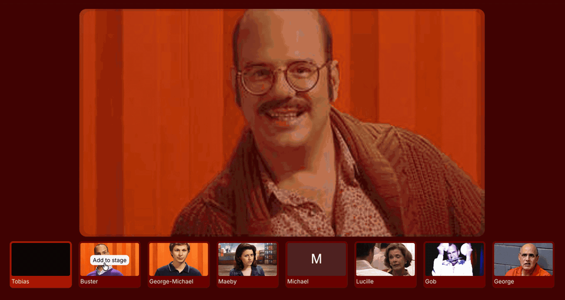

# Animated Stage Layouts

A React prototype exploring how video-call participants can smoothly rearrange as people join, leave, or get pinned. Originally developed while exploring animated stage layouts for Wistia Live. I built the original layout prototype without AI.

Three participants start on stage. Add more from the bottom strip, then pin or remove participants to see how the layout adapts.



## The layout experiment

I initially explored [Flexbox](src/layouts-flex.scss) and [CSS Grid](src/layouts-grid.scss). Both worked for individual arrangements, but became more restrictive when animating cards between positions and supporting different stage configurations.

I ultimately went with [absolute positioning](src/layouts-position.scss), which gave me direct control over each card's dimensions and coordinates. That made it easier to coordinate transitions as participants entered, exited, or moved around the stage.

It's a tradeoff: more responsibility for positioning logic in exchange for greater control over how the layout animates.

The positioning approach became the basis for Wistia Live's stage layouts and later supported additional configurations beyond those shown here.

## Run locally

Requires Node.js 20.19+ or 22.12+.

```sh
npm install
npm start
```

Open the local URL printed by Vite. Run `npm run build` to check TypeScript and create a production build.

Participant photos are loaded from remote URLs, with initials displayed as a fallback.
